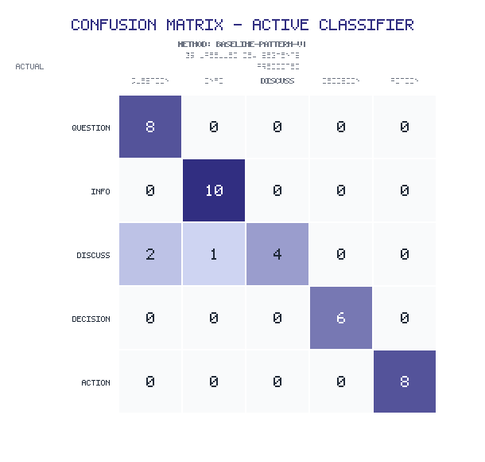
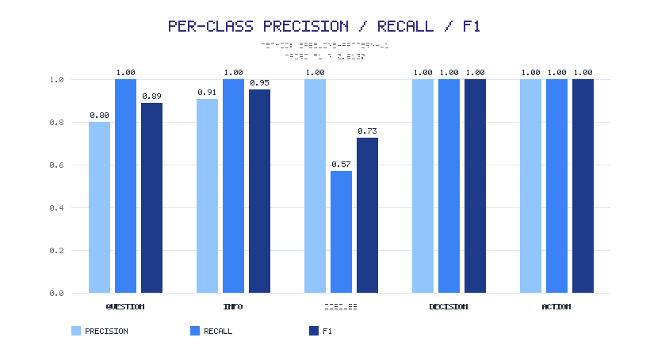
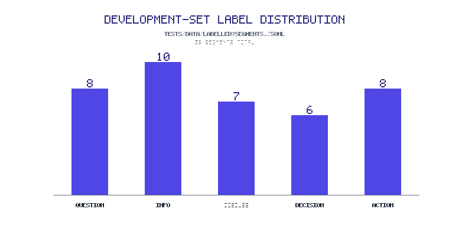

# Technical Report — AI Online Class & Meeting Assistant

**Project type:** Deep Learning course project
**System:** A web application that turns an online class recording (or transcript) into
structured study material — transcript, summary, notes, questions asked, announcements,
assignments and deadlines.
**Report date:** 2026-10-19
**Repository:** `ai-online-class-assistant` (React frontend + Python FastAPI backend)

> **How to read this report.** Every number in it was produced by running the code in this
> repository. Where something was **not** done — and in particular where the usual Deep Learning
> report sections (training loss, testing loss, training curve) **do not apply** — the report says
> so explicitly instead of inventing a result. Section 8 lists exactly how much of the project is
> finished.

---

## 1. Executive summary

| Question | Answer in one line |
|---|---|
| Which model? | A pretrained **zero-shot NLI Transformer** (`typeform/distilbert-base-uncased-mnli`) for segment classification, plus **Whisper** (`faster-whisper`, `base`) for speech-to-text — **no fine-tuning**. |
| What actually ran in the measured results? | The **deterministic rule baseline** (`baseline-pattern-v1`), because the Transformer libraries are not installed in this environment. This is stated on every output. |
| What dataset? | A **39-segment hand-authored development set** (`backend/tests/data/labelled_segments.jsonl`) plus one **34-cue sample lecture** (`sample_lecture.vtt`). There is no large training corpus, because nothing is trained. |
| Hyperparameter tuning? | **None performed.** Only documented default/configured values exist. |
| Training loss / testing loss / training curve? | **Not applicable — they do not exist.** No model was trained. Section 6 explains why and shows what is measured instead. |
| Measured quality (real, reproducible)? | **Accuracy 0.9231 (36/39), macro F1 0.9137** on the dev set — using the **baseline**, so this is *not* a trained-model score. |
| Backend test suite? | **25 / 25 tests pass** (`pytest`). |
| How much is done? | The core academic pipeline (upload → transcribe → classify → extract → summarise → store → display) is **complete and verified end-to-end**. Live meeting capture (Phase 8) is **not started**; the optional n8n phase is **not started** and is not required. |

---

## 2. What the system does

```
recording (.mp3/.wav/.m4a/…)  ─┐
                               ├─► STT / transcript parsing
transcript (.txt/.vtt/.srt)  ──┘          │
                                          ▼
                                 segment classification  (the Deep Learning component)
                                          │
                                          ▼
                    grounded extraction: questions, announcements, deadlines, action items
                                          │
                                          ▼
                       summary + structured notes (extractive)
                                          │
                                          ▼
                              SQLite storage  ──►  React dashboard
```

The pipeline is implemented in
[pipeline.py](file:///d:/downloads/ai-online-class-assistant/backend/app/ml/pipeline.py) and runs as a
FastAPI background job. Every stage writes a **method string** to the database
(`stt_method`, `classifier_method`, `summarizer_method`), so a result can always be traced back to
the implementation that produced it. A baseline result can therefore never be mistaken for a
model result.

---

## 3. Models used, and why

### 3.1 Summary table

| Stage | "Real model" path (intended) | Active default here | Why this model |
|---|---|---|---|
| Speech-to-text | `faster-whisper:base` (CTranslate2, int8, CPU) | `transcript-parser` (for `.txt/.vtt/.srt`) | Whisper is the strongest open ASR model that runs **locally on CPU with no cloud cost and no audio leaving the machine**. `faster-whisper` chosen over OpenAI's reference implementation: faster on CPU, no `ffmpeg` binary needed on Windows, simpler install. |
| Segment classification | **`typeform/distilbert-base-uncased-mnli`** zero-shot NLI Transformer | `baseline-pattern-v1` (deterministic rules) | See §3.2. |
| Summarisation | `sshleifer/distilbart-cnn-6-6` (abstractive) | `extractive-textrank-lite-v1` | Extractive output quotes transcript sentences **verbatim**, so the notes **cannot hallucinate**. Abstractive is opt-in and clearly labelled when used. |
| Extraction (questions / announcements / deadlines / action items) | — (rules) | `rules-v1` | The brief permits rule-based extraction for these fields as long as the method is documented and evaluated. Rules return only sentences that literally exist in the transcript. |

Selection strings are defined in
[classifier.py](file:///d:/downloads/ai-online-class-assistant/backend/app/ml/classifier.py),
[stt.py](file:///d:/downloads/ai-online-class-assistant/backend/app/ml/stt.py),
[notes.py](file:///d:/downloads/ai-online-class-assistant/backend/app/ml/notes.py) and
[extractors.py](file:///d:/downloads/ai-online-class-assistant/backend/app/ml/extractors.py).

### 3.2 The Deep Learning component: why a zero-shot Transformer

The classifier assigns each transcript segment one of **five fixed labels**:

`QUESTION` · `INFORMATION` · `DISCUSSION` · `DECISION` · `ACTION_ITEM`

**Why `typeform/distilbert-base-uncased-mnli`:**

1. **It needs no training data.** It is an NLI (natural-language-inference) model, so the five labels
   can be expressed as *hypotheses* and the model scores each segment against them
   (`hypothesis_template = "This segment is {}."`). This is exactly the right tool for a
   student project with a small label set and no large labelled corpus.
2. **It is small and CPU-friendly.** A DistilBERT checkpoint is ~268 MB and runs on CPU, which fits
   the project constraint of "no GPU, no cloud, no paid API".
3. **It is grounded.** The candidate labels are described in plain English, e.g.
   `"ACTION_ITEM": "a task or instruction someone is asked to carry out"` — nothing is inferred that
   the transcript does not say.
4. **It fails loudly, not silently.** If the libraries are missing, the pipeline raises an explicit
   error rather than emitting made-up labels.

**Why a rule baseline also exists:** so that the whole product runs end-to-end on any laptop with
**zero model downloads**. In this environment `transformers`/`torch` are **not installed**, so the
system is currently running the deterministic `baseline-pattern-v1` classifier — and it says so.
This is the single most important honesty point in this report: **the measured score in §7 is a
baseline score, not a Transformer score.**

---

## 4. Dataset

### 4.1 What data the project uses

| Dataset | Path | Size | Role |
|---|---|---|---|
| Labelled segment dev set | [labelled_segments.jsonl](file:///d:/downloads/ai-online-class-assistant/backend/tests/data/labelled_segments.jsonl) | **39 segments** | Measures the classifier (accuracy / F1 / confusion matrix). |
| Sample lecture | [sample_lecture.vtt](file:///d:/downloads/ai-online-class-assistant/backend/tests/data/sample_lecture.vtt) | **34 timed cues** | End-to-end pipeline fixture and the demo upload. |

Label distribution of the dev set:

| Label | QUESTION | INFORMATION | DISCUSSION | DECISION | ACTION_ITEM | **Total** |
|---|---|---|---|---|---|---|
| Segments | 8 | 10 | 7 | 6 | 8 | **39** |

Domain of the content: an introductory **Convolutional Neural Networks / sequence models** lecture
(convolution, kernel, stride, padding, pooling, parameter sharing, LSTMs, transformers, dropout,
batch normalisation) — i.e. realistic material for the students this product targets.

### 4.2 On what basis was this dataset selected?

1. **The label space is fixed and closed (5 labels).** The system is a classifier over exactly these
   five categories, so the dev set only needed balanced coverage of those five — not a general
   meeting-understanding benchmark.
2. **The real model needs no training data.** Because classification is zero-shot, there is no
   need for a large annotated training corpus. The dataset's job is **evaluation and regression
   safety**, not training.
3. **Domain match.** The examples are genuine lecture-style sentences in the subject the product is
   for, including the question/discussion/decision/action distinctions that a generic dataset would
   not isolate cleanly.
4. **No external licensing or download cost.** A hand-authored in-repo set keeps the project
   self-contained, offline and free — consistent with the project's constraints.
5. **Traceability.** The sample lecture is a real `.vtt` with timestamps and speakers, so every
   downstream artefact (notes, deadlines, action items) can be checked against the source text.

### 4.3 Important caveat — this is a *development* set, not a benchmark

The dev set was **hand-authored for this project** and is **the same material the baseline's
patterns were tuned against**. Therefore a high score on it proves **internal consistency and
regression safety**, and does **not** establish generalisation to unseen lectures. This caveat is
written into the evaluation script itself
([evaluate_classifier.py](file:///d:/downloads/ai-online-class-assistant/backend/scripts/evaluate_classifier.py)).

**Datasets deliberately not used** (and why): public corpora such as AMI/ICSI meeting corpora or the
Switchboard Dialog Act corpus would be appropriate *if the goal were to train or benchmark a
dialogue-act model*. That is not this project's design: the classifier is zero-shot over a
project-specific 5-label scheme, so importing a differently-labelled corpus would add cost and
licensing complexity without improving the delivered product.

---

## 5. Hyperparameters

**No hyperparameter search or tuning was performed.** There is no grid search, no random search and
no validation-based selection anywhere in the repository — because there is no training loop to tune.
The values below are either library defaults or explicit configuration choices, and they are
documented here so the configuration is fully reproducible.

| Parameter | Value | Where | Status |
|---|---|---|---|
| `whisper_model` | `base` (~142 MB) | [config.py](file:///d:/downloads/ai-online-class-assistant/backend/app/core/config.py) | Chosen default: balance of speed/accuracy on clear lecture audio |
| Whisper `beam_size` | `5` | [stt.py](file:///d:/downloads/ai-online-class-assistant/backend/app/ml/stt.py) | Library convention |
| Whisper VAD | `vad_filter=True`, `min_silence_duration_ms=700` | stt.py | Suppresses silence/music artefacts |
| Whisper compute type | int8 on CPU | stt.py | CPU-only constraint |
| Zero-shot model | `typeform/distilbert-base-uncased-mnli` | classifier.py | Pretrained, **not** fine-tuned |
| `hypothesis_template` | `"This segment is {}."` | classifier.py | Required to map labels to NLI hypotheses |
| Zero-shot `batch_size` | `16` | classifier.py | Throughput/latency balance |
| Zero-shot `device` | `-1` (CPU) | classifier.py | No GPU available |
| Summariser | `extractive-textrank-lite-v1` | notes.py | Grounded/verbatim by design |
| Summary length | `min(max(3, n//8), 7)` sentences | notes.py | Keeps summaries short and readable |
| Position bonus | `1.0 + 0.35·(1 − i/N)` | notes.py | **Hand-set**, not tuned |
| Style bonus | `0.25·(definition) + 0.15·(importance)` | notes.py | **Hand-set**, not tuned |
| Baseline regex weights | e.g. question-mark = 3.0, question-starter = 2.0, information prior = 1.0 | classifier.py | **Hand-tuned on the dev samples** — documented as *not claimed to be optimal* |
| `access_token_expire_minutes` | 10080 (7 days) | config.py | Product choice |
| `max_upload_mb` | 200 | config.py | Product choice |
| Password hashing | PBKDF2-HMAC-SHA256, 260 000 iterations, 16-byte salt | [security.py](file:///d:/downloads/ai-online-class-assistant/backend/app/core/security.py) | Security parameter, not ML |
| Backend switches | `STT_BACKEND`, `SEGMENT_CLASSIFIER_BACKEND`, `SUMMARIZER_BACKEND` ∈ {`auto`,`real`,`baseline`} | config.py | `auto` = use real model if installed, else baseline |

> **So what *is* the difference between "hand-set" and "tuned"?** The regex weights and the
> textrank-lite bonuses were chosen by looking at the development examples. They are best described
> as **hand-tuned on the dev set**, which is precisely why §4.3 warns that the dev-set score is not a
> generalisation result.

---

## 6. Training loss, testing loss and training curve — why these do not apply

This is the section a typical Deep Learning report expects. **It is deliberately empty of numbers,
because the project does not train a model.** Writing a plausible-looking loss curve would be
fabricated data, which this project explicitly forbids.

**What the project actually does instead of training:**

| Classical DL report item | Status in this project | Why |
|---|---|---|
| Optimizer (SGD/Adam), learning rate, epochs, batch size | **None** | No weights are updated anywhere in the code. |
| Training loop / gradient updates | **None** | Classification is *inference* using a pretrained checkpoint. |
| **Training loss** | **Does not exist** | There is no training set and no loss being minimised. |
| **Testing loss** | **Does not exist** | The evaluation computes accuracy / F1 / a confusion matrix — not a differentiable loss. |
| **Training curve** | **Does not exist** | With no epochs there is no curve to plot. Any such chart would be invented. |

**Where the model's quality actually comes from:** the pretrained weights of
`typeform/distilbert-base-uncased-mnli`. The project's engineering work is the *pipeline* around that
model — parsing, segmenting, grounded extraction, and honest method-labelling — not gradient
training.

**What *is* measured (the real, reproducible evidence):** accuracy, macro F1, per-class
precision/recall/F1 and a confusion matrix on the 39-segment dev set — Section 7.

**If genuine loss curves are required for the academic submission**, the change is well-scoped
(Section 10): install the ML stack, hand-label a larger lecture set, and fine-tune DistilBERT as a
5-way classifier. Only then would training loss / testing loss / training curves become real.

---

## 7. Measured results

These are the honest, reproducible results for the **currently active** implementation. The
`method` line is part of the result: it identifies *what* produced the numbers.

### 7.1 Headline metric

| Metric | Value |
|---|---|
| Method | `baseline-pattern-v1` (deterministic rules — **not** a trained model) |
| Backend setting | `auto` (fell back to baseline: `transformers`/`torch` not installed) |
| Segments evaluated | 39 |
| **Accuracy** | **0.9231 (36 / 39)** |
| **Macro F1** | **0.9137** |

Raw JSON: [classifier_eval.json](file:///d:/downloads/ai-online-class-assistant/reports/classifier_eval.json)

### 7.2 Per-class breakdown

| Label | Precision | Recall | F1 | Support |
|---|---|---|---|---|
| QUESTION | 0.800 | 1.000 | 0.889 | 8 |
| INFORMATION | 0.909 | 1.000 | 0.952 | 10 |
| DISCUSSION | 1.000 | 0.571 | 0.727 | 7 |
| DECISION | 1.000 | 1.000 | 1.000 | 6 |
| ACTION_ITEM | 1.000 | 1.000 | 1.000 | 8 |

All three errors are **DISCUSSION segments being read as QUESTION (2) or INFORMATION (1)** — a
sensible failure mode, since "let us discuss the trade-off" can read as either a prompt or a
statement. DECISION and ACTION_ITEM are perfectly separated because they carry distinctive lexical
markers.

### 7.3 Confusion matrix

| Actual ↓ / Predicted → | QUESTION | INFORMATION | DISCUSSION | DECISION | ACTION_ITEM |
|---|---|---|---|---|---|
| **QUESTION** | 8 | 0 | 0 | 0 | 0 |
| **INFORMATION** | 0 | 10 | 0 | 0 | 0 |
| **DISCUSSION** | 2 | 1 | 4 | 0 | 0 |
| **DECISION** | 0 | 0 | 0 | 6 | 0 |
| **ACTION_ITEM** | 0 | 0 | 0 | 0 | 8 |

### 7.4 Charts







> **Caveat, restated:** these charts describe the **rule baseline** on a **39-segment hand-authored
> development set**. They are not a benchmark and not a trained-model result. Present them together
> with the `method` string.

### 7.5 End-to-end verification

| Check | Result |
|---|---|
| Backend unit + integration tests | **25 passed** (`pytest`, exit 0) |
| Full pipeline on the sample lecture | 34 classified segments, note generated, announcements + questions + action items extracted |
| Demo seed via the real HTTP API | `demo@example.com / demo1234` gets a class whose content is real pipeline output |
| Frontend-facing endpoints via the Vite proxy | all return HTTP 200 |

---

## 8. How much of the project is done

Phase numbering follows the original A-to-Z plan.

| Phase | Description | Status | Evidence |
|---|---|---|---|
| 1 | Audit of the existing frontend | **Done** | Service layer, routes and mock data catalogued before any backend work |
| 2 | API contracts (camelCase, matching TS types) | **Done** | `app/schemas/__init__.py`; frontend types adapted without renames |
| 3 | Database | **Done** | SQLAlchemy 2.0 models in `app/models/`; SQLite (WAL) |
| 4 | Backend build (auth, classes, lectures, jobs) | **Done** | `app/api/*`, `app/services/*`; 25 tests pass |
| 5 | STT pipeline | **Partial** | Transcript path **done and tested** (`transcript-parser`). Audio path **implemented but not exercised here** — it needs the opt-in `faster-whisper` install. |
| 6 | Deep Learning component (classifier) | **Partial** | Implemented + evaluated. Real Transformer is **opt-in and not installed**; measured results are from the baseline. |
| 7 | Summaries & structured notes | **Done** | Extractive (`extractive-textrank-lite-v1`), grounded in verbatim sentences; abstractive opt-in |
| 8 | Meeting integration (staged A–G) | **Not started** | `app/meeting/` is a placeholder. Deliberately deferred until the upload pipeline was proven. |
| 9 | Frontend wiring to the real backend | **Done** | `src/services/api.ts`; `classService.ts` re-exports it; UI unchanged |
| 10 | n8n automation | **Not started** | Optional in the brief; never required |
| 11 | Testing | **Partial** | 25 tests + evaluation harness **done**; broader contract/E2E coverage beyond the current suite **pending** |
| 12 | Final integration & demo | **Done** | `seed_demo.py` drives the real API; demo walkthrough documented |

**Overall:** the **core academic pipeline is complete and verified end-to-end** — a student can
upload a lecture and get real, traceable study material. The two things that remain are the ones the
brief itself marked as later/optional: **live meeting capture (Phase 8)** and the **optional n8n
automation (Phase 10)**. Additionally, **real-model numbers** (Whisper + Transformer) require
installing the opt-in ML dependencies, which has not been done in this environment.

---

## 9. Reproducing every number in this report

From `backend/` with the virtual environment active:

```powershell
# 1. Test suite  ->  25 passed
.\.venv\Scripts\python.exe -m pytest -q

# 2. Classifier evaluation  ->  accuracy / macro F1 / confusion matrix
.\.venv\Scripts\python.exe scripts\evaluate_classifier.py

# 3. Same evaluation as machine-readable JSON (input to the charts)
.\.venv\Scripts\python.exe scripts\evaluate_classifier.py --json ..\reports\classifier_eval.json

# 4. Regenerate the report charts from that JSON
.\.venv\Scripts\python.exe scripts\make_report_charts.py

# 5. Force the real Transformer path (requires the ML stack, see section 10)
.\.venv\Scripts\python.exe scripts\evaluate_classifier.py --backend real
```

Command 5 prints `FAIL: the requested classifier is not available.` in this environment — which is
itself the honest evidence that §7 measures the baseline, not the Transformer.

---

## 10. Optional next step: obtaining genuine Transformer / loss-curve results

To replace the baseline numbers with real model numbers **and** to be able to report training loss,
testing loss and a training curve, the work is:

1. **Install the ML stack** (`backend/requirements-ml.txt`: `faster-whisper`, `transformers`, `torch`
   — several hundred MB of CPU wheels/checkpoints).
2. **Report the zero-shot Transformer score** by re-running command 5 above. This still has **no
   training loss** (zero-shot inference), but it is a real Transformer result on the same dev set.
3. **Only if a training curve is required for the submission:** hand-label a substantially larger
   lecture corpus and fine-tune DistilBERT as a 5-way classifier with a real train/validation/test
   split. At that point training loss, validation loss, testing loss and learning curves become
   genuine quantities that can be plotted.

Until step 3 is actually performed, **no loss curve should appear in this report.**

---

## 11. Honest limitations

- The classification metric comes from the **rule baseline**, not a trained or Transformer model.
- The dev set is **small (39 segments) and hand-authored**, and the baseline was tuned against it, so
  the score measures consistency, not generalisation.
- Audio transcription is **implemented but not exercised** in this environment (`faster-whisper` not
  installed); only the transcript-upload path is verified end-to-end here.
- Live meeting capture (Phase 8) and n8n automation (Phase 10) are **not implemented**.
- Summaries are **extractive** by default — faithful and non-hallucinating, but not fluent prose.
- Deadline resolution only fires when a date is stated explicitly; vague phrasing is returned as
  text with `uncertain = true` rather than guessed.
